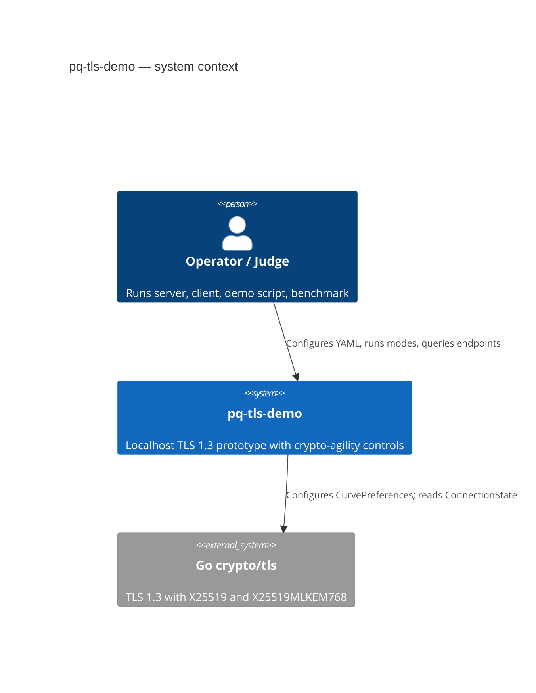

# Architecture

This document describes the Iteration 1–5 prototype as implemented in this
repository. The application does **not** hard-code business logic to classical
or hybrid cryptography: configuration selects a `CryptoProvider` and a separate
`CryptoPolicy`, then TLS negotiation, inventory, and policy evaluation observe
the result.

## Lifecycle

```text
Configure → Negotiate → Observe → Assess → Enforce → Measure
```

## C4-style context



## Container / component view

```mermaid
flowchart TB
  Operator[User / Operator]
  Config[crypto-policy.yaml]
  Provider[CryptoProvider]
  Policy[CryptoPolicy]
  TLS[TLS 1.3 handshake]
  State[tls.ConnectionState]
  Bench[Benchmark mode]
  CBOM[CBOM-inspired inventory /cbom]
  Eval[PolicyEvaluator]
  Events[Security Events /security-events]
  Status[/status]

  Operator --> Config
  Config --> Provider
  Config --> Policy
  Provider --> TLS
  TLS --> State
  Operator --> Bench
  State --> CBOM
  State --> Eval
  Policy --> Eval
  Eval --> Events
  State --> Status
  Eval --> Status
```

## Design property

Application handlers depend on the `CryptoProvider` interface and policy
evaluator, **not** on whether the configured provider is classical or hybrid.
Changing posture is a configuration change, not an application rewrite.

## Endpoints

| Path | Role |
| --- | --- |
| `/` | Prints negotiated TLS + policy status for the current connection |
| `/cbom` | CBOM-inspired inventory (configured vs negotiated) |
| `/status` | Provider, policy, last negotiated group, policy status |
| `/security-events` | Recent in-memory structured events |

## Packages

| Path | Responsibility |
| --- | --- |
| `.` (main) | Server, client, CLI, posture store |
| `crypto/` | Providers, inventory, policy, events |
| `experiment/` | Controlled HNDL educational harness (isolated from TLS path) |
| `benchmark/` | Handshake timing measurement |
| `config/` | YAML posture files for default and demo scenarios |
| `docs/` | Evaluation and presentation artifacts |
| `scripts/` | Reproducible demo orchestration |
| `results/` | Measured outputs from demo/benchmark runs |
